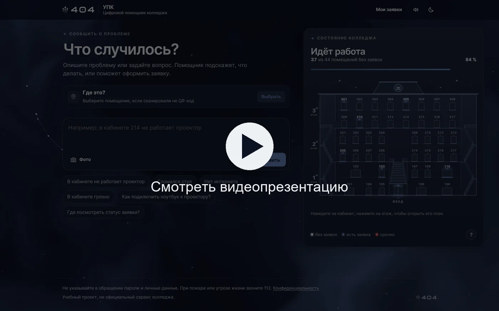
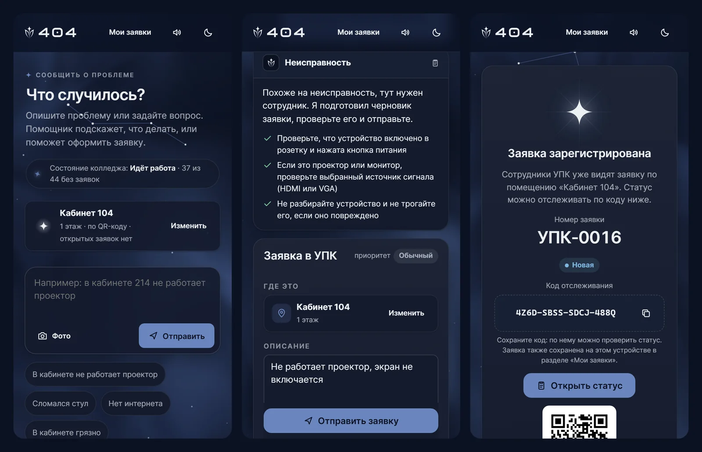
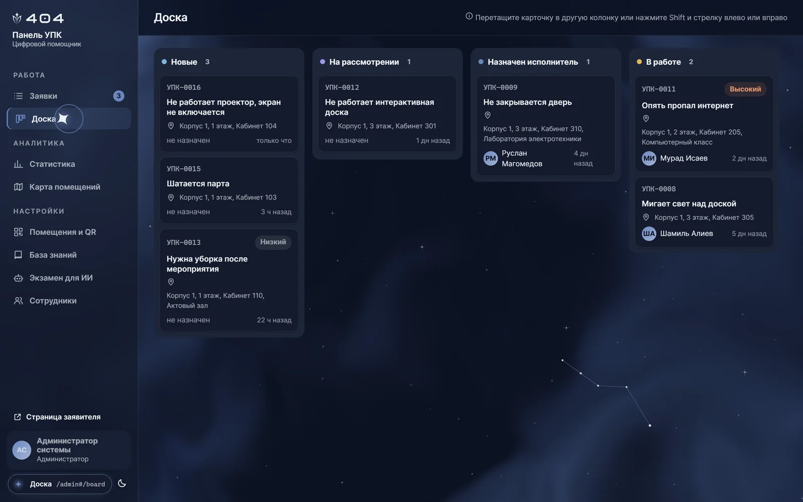
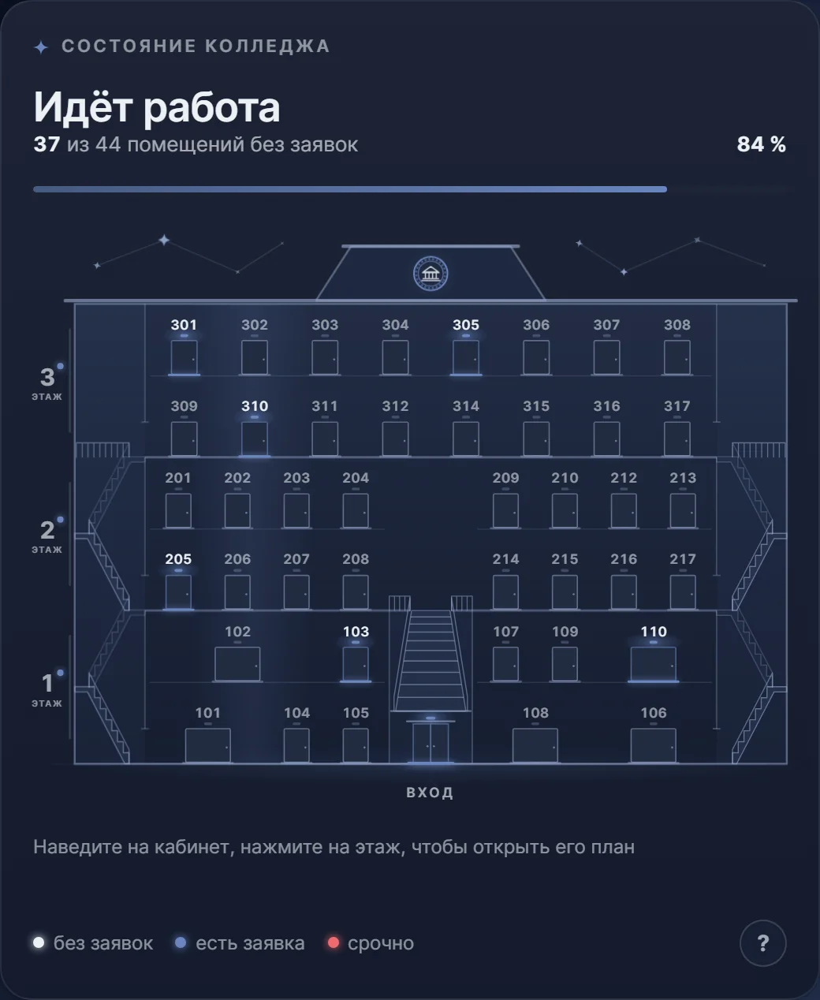
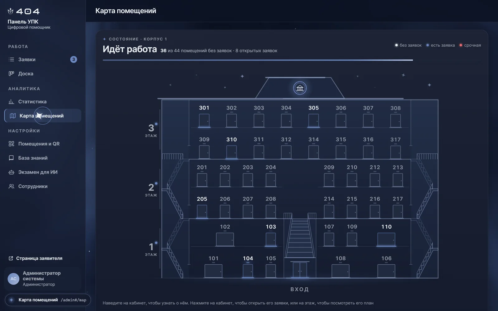
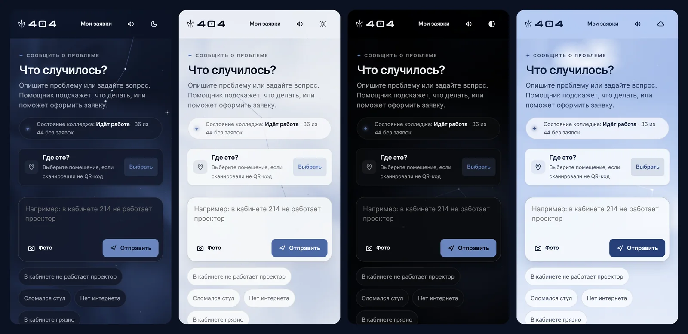
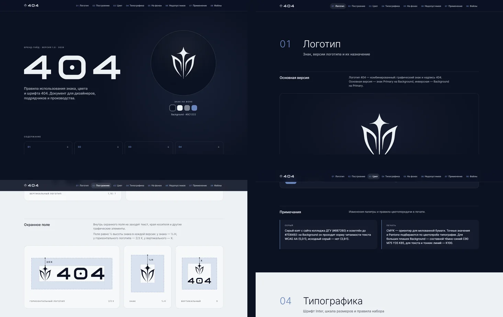

<h1 align="center">Цифровой помощник колледжа ДГУ</h1>

  Увидел проблему в кабинете, отсканировал QR-код, описал её своими словами. 
  Заявка уже у того, кто её решит, а ты видишь, что с ней происходит.

  <a href="https://404upk.duckdns.org"><b>Открыть сайт</b></a> ·
  <a href="https://vkvideo.ru/video-242996997_456239017?list=ln-7gc1sFzZaKxPVgFAUM"><b>Видеопрезентация</b></a> ·
  <a href="brand/404-brandbook.pdf"><b>Брендбук</b></a>

## Видеопрезентация

## Зачем это колледжу

Сломался проектор, не работает розетка, в кабинете холодно. Обычно об этом говорят на ходу или пишут в чат: сообщение теряется, студент не знает, услышали ли его, а сотрудники не видят общей картины.

Мы делаем для своего колледжа один понятный путь. У каждого кабинета есть QR-код, у каждой проблемы есть номер и ответственный, а у студента есть способ узнать, чем всё закончилось. Не нужны ни приложение, ни регистрация, ни знание того, кому звонить.

## Как это работает

1. **QR-код в кабинете.** Сайт открывается в браузере, кабинет уже выбран. Без QR-кода его можно найти в списке или написать вручную.
2. **Помощник.** Студент пишет обычными словами. Если это вопрос, помощник отвечает по базе знаний колледжа. Если неисправность, подсказывает безопасные проверки и сам готовит черновик заявки.
3. **Одно нажатие.** Форма уже заполнена. Если об этой проблеме в кабинете уже сообщили, можно присоединиться к заявке вместо того, чтобы создавать дубль.
4. **Статус.** Студент получает номер и код отслеживания и видит пять этапов от регистрации до решения. Страница обновляется сама.

### Панель сотрудников

- Список заявок с поиском и фильтрами, карточка с историей всех действий, внутренние и публичные комментарии.
- Доска с перетаскиванием заявок между статусами, контекстное меню на правой кнопке мыши.
- Статистика: заявки по дням, категориям и помещениям, среднее время решения, повторяющиеся проблемы, оценки студентов.
- Помещения и QR-коды: добавление, перевыпуск кода и готовые листы A4 для печати.
- Редактор базы знаний и «Экзамен для ИИ»: сценарии, на которых помощника проверяют прямо из панели.
- Выгрузка в Excel и CSV, разделение ролей: администратор, сотрудник, исполнитель.

### Здание на экране

Весь колледж виден сразу: фасад и планы этажей нарисованы по его настоящей архитектуре, а каждое помещение показывает своё состояние. Сотрудник замечает, где накопились заявки, а студент видит, что колледж в целом работает и его проблема не единственная забота.

  
  

## Почему мы сделали ребрендинг

У сервиса, которым пользуется весь колледж, должно быть своё лицо. Без него это ещё одна безымянная форма, а безымянной форме не доверяют и заполнять её не хочется. Поэтому мы собрали единый бренд с нуля: знак, цвет, шрифт и правила их применения.

Новизна здесь не ради новизны. Бренд вырос из самого колледжа:

- **Знак** построен на его эмблеме: звезда над стеблем, по бокам щит с колоннами портика.
- **Палитра** взята с сайта колледжа. Серый мы только осветлили, чтобы текст на тёмном фоне проходил норму читаемости.
- **Шрифт** Inter спокойный и хорошо читается и на телефоне, и на распечатанном листе с QR-кодом.

### Почему мы чуть отошли от строгости

Официальные сервисы обычно строгие, и у этого есть причина: строгость вызывает доверие. Но наш сайт открывают в другой момент: на перемене, с телефона, когда что-то не работает и человек уже раздражён. Сухая канцелярская форма в такую минуту срабатывает против нас. Студент её закрывает, и проблема остаётся в кабинете.

Поэтому мы разделили две вещи:

- **Строгим осталось всё, что касается дела.** Статусы, история действий, права доступа, понятные формулировки, обычная карта без украшений. Рабочие экраны сотрудников не отвлекают.
- **Мягче стала только подача.** Живой фон, плавные переходы, тихий звук и разговор с помощником вместо бланка. Сайт приятно открыть, поэтому сообщить о проблеме не кажется обязанностью.

Это не отказ от серьёзности, а выбор, где она нужна. И всё лишнее можно выключить: звук отключается одной кнопкой, а при системной настройке «уменьшить движение» анимации замирают.

### Почему звёзды

Звезду мы не придумали: она уже стоит на вершине эмблемы колледжа. Мы просто дали ей продолжение. Отсюда глубокий тёмно-синий фон, звёзды в заставке, искры при выделении текста, переход между страницами и звук, собранный из синтезированных звёздных нот.

У этого решения три причины:

- **Узнаваемость.** Каждая деталь работает на один образ, поэтому сайт нельзя спутать с шаблоном.
- **Смысл.** Звезда это ориентир, а сайт как раз показывает проблеме дорогу к тому, кто её решит.
- **Практика.** Тёмный фон спокоен для глаз и в затемнённой аудитории с проектором. Кому нужно иначе, тот выберет одну из четырёх тем, и знак подстроится под каждую.

## Брендбук

Бренд описан полностью, и его можно передать дизайнеру, подрядчику или в типографию: конструкция знака и охранное поле, версии логотипа, палитра с контрастом по WCAG, типографика, применение на носителях и недопустимые варианты.

| Цвет | Значение | Роль |
|---|---|---|
| Снежный | `#EDF0F4` | знак, заголовки, основной текст |
| Полночный | `#0C1222` | главная поверхность бренда |
| Сланцевый | `#7D8492` | второстепенный текст и подписи |
| Васильковый | `#6A86BE` | акценты, ссылки, маркеры |

**[Брендбук в PDF](brand/404-brandbook.pdf)** · **[Пакет логотипов](brand/404-logos.zip)**: 119 файлов в SVG, PDF и PNG, иконки и фавикон.

## Проработано до мелочей

Мы прошлись по каждому экрану. Вот лишь то, что обычно остаётся стандартным:

**Свои элементы вместо системных**
- Своё меню правой кнопки мыши с действиями под каждую страницу и своё меню в текстовых полях.
- Свои подсказки при входе вместо выпадающего списка браузера.
- Своё выделение текста, перетаскивание, подсказка при наведении на ссылку.
- Переходы между страницами со знаком 404. Звук синтезируется прямо в браузере, без единого аудиофайла.
- Отдельный вариант логотипа для каждой темы. Страница печати QR-кодов показывает листы A4 в настоящих пропорциях.

**Надёжность там, где её не видно**
- Черновик заявки переживает обрыв сети и перезагрузку страницы, а заявка без сети уйдёт сама, когда связь вернётся.
- Двойное нажатие не создаст две заявки. Черновик одного кабинета не попадёт в другой.
- Перед отправкой фото сжимается, геометка и другие скрытые данные удаляются.
- Если ИИ недоступен, помощник продолжает работать на встроенных правилах и базе знаний.
- Помощник отвечает только по проверенной базе и не выполняет команды, спрятанные в сообщениях.

**Проверено, а не обещано**
- **Скорость.** В наших замерах главный элемент страницы появляется примерно за 0,2 секунды, а повторная загрузка весит около 6 КБ.
- **Доступность.** 30 экранов студента и сотрудника в четырёх темах и на телефоне проверены axe-core. Страница работает с клавиатуры, при увеличении до 400 % и на ширине 320 пикселей.
- **Качество.** Более 200 автоматических тестов, включая браузерные, запускаются при каждом изменении, на SQLite и на PostgreSQL.
- **Безопасность.** Строгая политика безопасности контента, хранение паролей в bcrypt, ограничение попыток входа.

## Технологии

FastAPI, SQLAlchemy, PostgreSQL, GigaChat. Интерфейс на чистом JavaScript без сборки и тяжёлых библиотек, поэтому он такой быстрый.

## Статус проекта

Сейчас это демо-версия, подготовленная для хакатона. Мы показываем, каким видим этот сервис для нашего колледжа.

<b>Команда 404</b>

