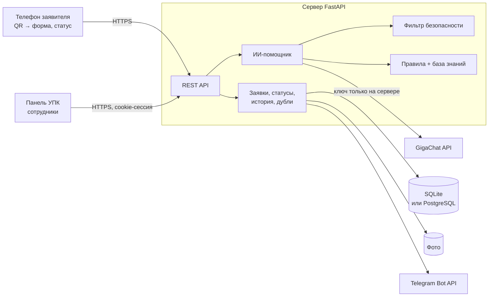
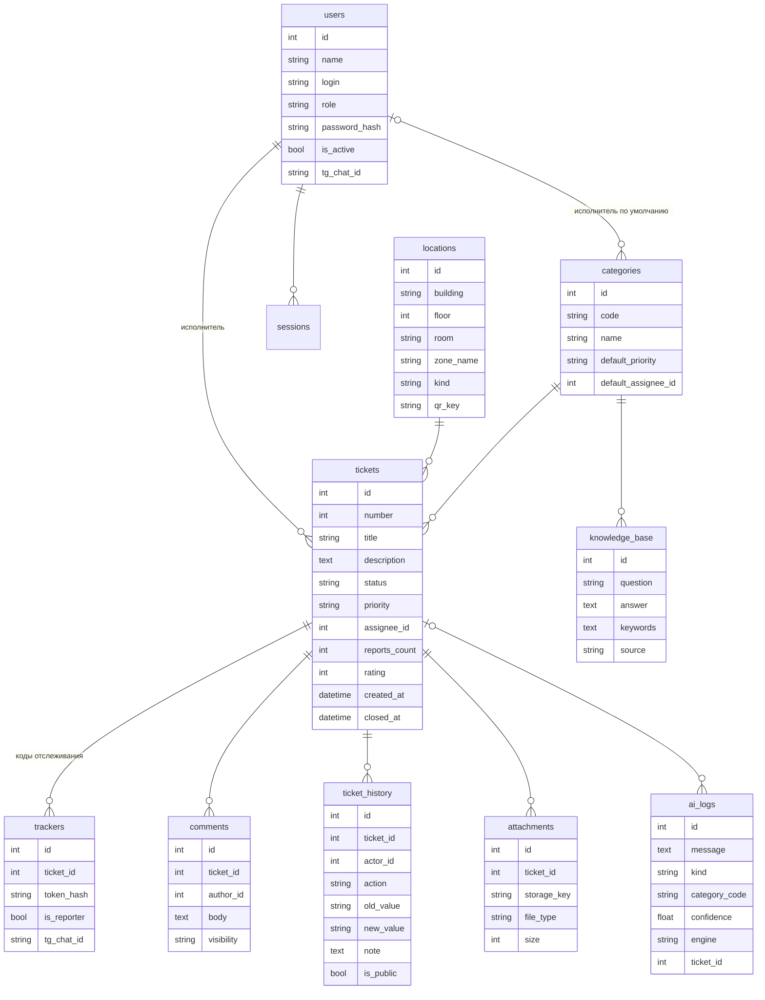

# УПК: цифровой помощник колледжа

Веб-система для обращений о проблемах с помещениями, оборудованием и инфраструктурой колледжа.
Человек сканирует QR-код в кабинете, описывает проблему, ИИ-помощник сразу отвечает или помогает оформить заявку,
а сотрудник УПК ведёт её в панели до решения. Заявитель следит за статусом по коду отслеживания или в Telegram.

Ничего устанавливать на телефон не нужно, всё работает в браузере.

**Команда:** [Тимур: ИИ, бэкенд, инфраструктура](docs/team/TIMUR.md) · [Осман: фронтенд](docs/team/OSMAN.md) ·
[Азамат: карта обучения](docs/team/AZAMAT.md) · [Брендбук](docs/brand/404-brandbook.pdf) · [Логотипы](docs/brand/404-logos.zip)

## Состояние помещений

Система показывает состояние каждого помещения колледжа: нет открытых заявок, есть заявка, есть срочная заявка.

- **Сводка по колледжу**: доля помещений без заявок («Всё работает», «Идёт работа», «Повышенная нагрузка»), `GET /api/campus`.
- **Помещение на странице QR-кода**: видно, о чём уже сообщили, и можно присоединиться к заявке
  вместо дубля, `GET /api/locations/{id}/status`.
- **Ход заявки** на странице статуса: пять этапов от регистрации до решения.
- **Карта помещений** в панели: корпус по этажам, пунктирное кольцо — 3+ заявки за 30 дней.

Оформление — по бренд-гайду 404: палитра сайта колледжа ДГУ (Полночный, Снежный, Сланцевый, Васильковый), Inter,
живой фон с реакцией на курсор. Светлая тема — по переключателю. При настройке «уменьшить движение» анимации отключаются.

## Что умеет

**Заявитель**
- открывает форму по QR-коду, кабинет подставляется сам; без QR выбирает место из списка или пишет вручную
- пишет проблему или вопрос, прикладывает фото (фото сжимается, геометка и прочий EXIF удаляются)
- получает ответ ИИ: инструкцию из базы знаний, безопасные проверки, уточняющий вопрос или предупреждение об опасности
- видит, если о такой же проблеме в этом кабинете уже сообщили, и может присоединиться к заявке вместо дубля
- получает номер заявки и код отслеживания, следит за статусом, отвечает на уточнения, оценивает работу
- может включить уведомления о статусе в Telegram

**Сотрудник УПК**
- список заявок с поиском по номеру, кабинету и тексту, фильтрами по статусу, категории, месту, исполнителю, приоритету и дате
- карточка заявки: назначение исполнителя (система подсказывает, кто отвечает за категорию), приоритет, категория,
  смена статуса, публичные и внутренние комментарии, полная история действий
- канбан-доска с перетаскиванием между статусами
- статистика: заявки по дням, категориям, помещениям и статусам, среднее время решения, повторяющиеся проблемы,
  работа ИИ, оценки заявителей
- карта помещений по этажам: видно, где есть открытые и срочные заявки и где проблемы повторяются
- помещения и QR-коды: добавление, перевыпуск кода, скачивание PNG, лист для печати
- редактор базы знаний, на которой отвечает ИИ
- «Экзамен для ИИ»: прогон сценариев из ТЗ прямо из панели и песочница для любых сообщений
- выгрузка заявок в Excel и CSV
- Telegram-бот: новые заявки приходят в чат, взять заявку и начать работу можно кнопкой

**Роли**: администратор (всё, включая сотрудников и маршрутизацию), сотрудник УПК (работа с заявками и справочниками),
исполнитель (видит только свои заявки, переводит их в работу и пишет комментарии).

## Быстрый запуск

**В браузере, без установки:** [открыть в Codespaces](https://codespaces.new/404-upk/404-upk?quickstart=1). Зависимости поставятся,
а сайт запустится сам, порт 8000 откроется в новой вкладке. Ключ GigaChat можно добавить как секрет Codespaces `GIGACHAT_AUTH_KEY`,
без него работает демо-режим.

Нужен Python 3.11 или новее.

**Windows:** дважды кликнуть `start.bat`.
**Linux / macOS:** `./start.sh`.

Скрипт создаст окружение, поставит зависимости, скопирует `.env.example` в `.env` и запустит сервер.
При первом запуске он попросит ключ GigaChat и сохранит его в `.env` на этом компьютере. Без ключа помощник
работает в демо-режиме на правилах и базе знаний.
Дальше открыть:

- http://localhost:8000: страница заявителя
- http://localhost:8000/admin: панель УПК
- http://localhost:8000/api/docs: документация API (Swagger)

Вручную то же самое:

```bash
python -m venv .venv
.venv/Scripts/pip install -r requirements.txt      # Linux/macOS: .venv/bin/pip
cp .env.example .env
.venv/Scripts/python -m uvicorn app.main:app --host 0.0.0.0 --port 8000
```

Через Docker:

```bash
cp .env.example .env
docker compose up -d --build
```

При первом запуске база заполняется демо-данными: категории, 22 помещения в двух корпусах, 13 статей базы знаний (4 из них по официальным инструкциям УПК),
сотрудники и 15 заявок за последние две недели, чтобы статистика и карта были не пустыми.
Пересоздать базу: `python -m app.seed --reset` (без демо-заявок: `--reset --clean`).

## Демо-доступ

| Роль | Логин | Пароль |
|---|---|---|
| Администратор | `admin` | `upk-admin-2026` |
| Сотрудник УПК | `upk` | `upk-staff-2026` |
| Исполнитель (электрик) | `electric` | `upk-exec-2026` |
| Исполнитель (сисадмин) | `it` | `upk-exec-2026` |
| Исполнитель (хозслужба) | `service` | `upk-exec-2026` |
| Исполнитель (клининг) | `cleaning` | `upk-exec-2026` |

Пароли меняются в `.env`, кнопки быстрого входа на странице логина выключаются через `SHOW_DEMO_LOGINS=false`.

## Демо QR-коды

| Место | Ссылка |
|---|---|
| Кабинет 214 (Корпус 1, 2 этаж) | `/r/r214qa9f` |
| Кабинет 305 (Корпус 1, 3 этаж) | `/r/r305gc7v` |
| Компьютерный класс 205 (лаборатория) | `/r/lab205jr` |
| Главный холл (общая зона) | `/r/hall9wze` |
| Библиотека (Корпус 2) | `/r/libr5xcj` |

Готовый лист для печати: панель → «Помещения и QR» → «Печать QR-кодов». QR содержит только идентификатор места.
Чтобы коды открывались с телефона, в `.env` должен стоять реальный адрес сервера в `PUBLIC_URL`.

## Сценарий проверки

1. Отсканировать QR кабинета 214 и написать «В кабинете 214 не работает проектор».
2. ИИ определит неисправность, категорию «Оборудование» и подготовит черновик заявки. Отправить, получить номер и код.
3. Войти в панель как `upk`, найти заявку, назначить исполнителя (система предложит сисадмина), перевести в «В работе».
4. Добавить комментарий и перевести в «Решена» с описанием работ.
5. Открыть страницу отслеживания: статус «Решена», комментарий виден, можно поставить оценку.
6. В статистике и истории видны все изменения.
7. Написать помощнику «В розетке искрит» и «Сколько стоит обучение?»: опасная ситуация без советов по ремонту
   и честный ответ, что проверенной информации нет.

## Архитектура



- **Бэкенд:** Python, FastAPI, SQLAlchemy 2, миграции Alembic. Локально SQLite, на сервере PostgreSQL через `DATABASE_URL`.
- **Фронтенд:** HTML, CSS и JavaScript-модули без сборки, раздаются тем же сервером. Адаптивная вёрстка,
  светлая и тёмная тема, можно добавить на главный экран телефона.
- **ИИ:** GigaChat API через сервер, с фильтром безопасности и запасным режимом на правилах.
- **Инфраструктура:** Docker, Caddy (HTTPS), GitHub Actions (тесты на SQLite и PostgreSQL, запуск боевого окружения), Dependabot.

```
app/
  main.py          сборка приложения: запуск, обработка ошибок, подключение роутеров
  middleware.py    заголовки безопасности, проверка источника запроса, сжатие, чистка журналов
  config.py        настройки и проверка готовности к боевому запуску
  models.py        модели базы данных
  migrations/      версии схемы базы, применяются при старте
  security.py      пароли, сессии, коды отслеживания, лимиты запросов
  routers/         public (заявитель), track (статус), auth, staff (панель), manage (справочники), pages (HTML-страницы)
  services/        заявки и статусы, представления для API, выгрузка, дубли, статистика, карта помещений, QR, фото,
                   Telegram-бот, сроки хранения данных
  ai/              safety, rules, knowledge, gigachat, prompts, assistant, selftest
  seed.py          заполнение базы начальными данными
  seed_data.py     сами данные: категории, помещения, база знаний, демо-заявки
web/               страницы и статика
tests/             автотесты по критериям приёмки
deploy/            боевой запуск: Caddy, PostgreSQL, приложение
docs/              файлы команды и брендбук
```

## Модель данных



Статусы: Новая → На рассмотрении → Назначен исполнитель → В работе → Решена, плюс «Нужны уточнения» и «Отклонена».
Переходы проверяются на сервере. Для «Решена», «Отклонена» и «Нужны уточнения» комментарий обязателен, его видит заявитель.
Каждое изменение пишется в историю с автором и временем.

## ИИ-помощник

Ответ собирается в три слоя:

1. **Фильтр безопасности** срабатывает до модели. Искры, дым, запах гари, вода рядом с электрикой, просьбы научить
   чинить проводку или вскрыть технику, просьбы о паролях: на это всегда фиксированный безопасный ответ,
   и модель его изменить не может.
2. **GigaChat** получает базу знаний и правила и возвращает JSON: тип сообщения, категорию, уверенность, ответ,
   номера статей, на которые опирается, черновик заявки и уточняющий вопрос.
3. **Проверка ответа модели.** Ответ «по базе знаний» без ссылки на статью считается выдумкой и заменяется честным
   «проверенной информации нет». При уверенности ниже порога решение передаётся человеку. Опасные советы
   в ответе блокируются, телефоны, почта и ссылки, которых нет в базе знаний, вырезаются.

Если ключ GigaChat не задан или API не ответил, работает запасной режим на правилах и той же базе знаний.
Интерфейс прямо пишет, каким способом получен ответ, и показывает уверенность и источник.

Подключение GigaChat:
1. Получить ключ авторизации в личном кабинете https://developers.sber.ru (раздел GigaChat API).
2. Вставить ключ, когда `start.bat` его попросит, или вписать в `GIGACHAT_AUTH_KEY` в `.env` и перезапустить сервер.
   Сертификат Минцифры, нужный для подключения, уже лежит в `certs/`.

С подключённым GigaChat дополнительно работает распознавание фото: ИИ описывает, что сломано, и предлагает категорию.

**Ограничения.** ИИ не закрывает заявки, не называет сроки ремонта и не знает ничего за пределами базы знаний.
Качество ответов на вопросы зависит от того, насколько полно заполнена база знаний. Классификация на правилах
в запасном режиме понимает типовые формулировки, но хуже справляется с необычными.

## Безопасность

- пароли хранятся только как хеши bcrypt, вход ограничен по числу попыток
- сессия сотрудника в HttpOnly-cookie, в базе только хеш токена, срок жизни ограничен
- права проверяются на сервере для каждого действия; исполнитель видит только свои заявки
- код отслеживания: 16 случайных символов (около 78 бит), в базе только хеш; подбор ограничен лимитом запросов
- присоединившийся к чужой заявке видит статус, но не описание и фото
- внутренние комментарии и имена исполнителей заявителю не показываются
- фото перекодируется в JPEG, размер и тип ограничены, файлы отдаются только по коду заявки или сотруднику
- ключи GigaChat и Telegram только в `.env` на сервере, в коде и репозитории их нет
- заголовки CSP, HSTS, COOP, X-Frame-Options, Referrer-Policy no-referrer (код отслеживания из адреса не утекает на другие сайты)
- запросы с чужих сайтов отклоняются, cookie сессии `SameSite=Strict`, размер запроса ограничен
- ошибка сервера никогда не показывается как успешная отправка; повторное нажатие не создаёт дубль заявки
- в боевом режиме (`APP_ENV=production`) сервер не запустится с демо-паролями, без HTTPS и без PostgreSQL

## Приватность

- телефоны, почта, номера карт и пароли вырезаются перед отправкой в модель и в журнал ИИ
- коды отслеживания не попадают в журналы сервера, журнал запросов Caddy выключен
- тексты обращений к ИИ и контакты заявителей удаляются сами через 90 дней (`AI_LOG_RETENTION_DAYS`, `CONTACT_RETENTION_DAYS`)
- нет сторонней аналитики, шрифтов и скриптов; заявки и панель закрыты от поисковиков
- условия описаны на странице `/privacy`; перед внедрением её должен проверить юрист колледжа

## Тесты

```bash
.venv/Scripts/pip install -r requirements-dev.txt
.venv/Scripts/python -m pytest
```

В `tests/test_acceptance.py` все критерии приёмки из ТЗ, в `tests/test_ai_guards.py` защиты вокруг
языковой модели: ответы GigaChat подменяются выдуманными, опасными и сломанными, и проверяется, что до пользователя
они не доходят. В `tests/test_hardening.py` безопасность, приватность, скорость, SEO и совпадение миграций с моделями.
Сеть и ключ для тестов не нужны.

| Критерий | Тест |
|---|---|
| AT-01 QR открывает форму с помещением | `test_at01_*` |
| AT-02 уникальный номер, нет дублей при повторной отправке | `test_at02_*` |
| AT-03 заявка видна в панели | `test_at03_*` |
| AT-04 поиск и фильтры | `test_at04_*` |
| AT-05 исполнитель, статус, комментарий | `test_at05_*` |
| AT-06 страница отслеживания | `test_at06_*` |
| AT-07 ответ на типовой вопрос | `test_at07_*` |
| AT-08 неисправность → заявка | `test_at08_*` |
| AT-09 опасный запрос | `test_at09_*` |
| AT-10 неизвестный вопрос | `test_at10_*` |
| AT-11 без входа панель недоступна | `test_at11_*` |
| AT-12 история изменений | `test_at12_*` |

## Развёртывание

Нужен VPS с Docker и домен, который указывает на сервер. HTTPS настроится сам.

```bash
git clone <репозиторий> upk && cd upk
cp deploy/.env.prod.example .env        # указать домен, ключи и свои пароли
docker compose --env-file .env -f deploy/docker-compose.prod.yml up -d --build
```

Запустятся Caddy, приложение и PostgreSQL. Если что-то опасное осталось по умолчанию, приложение не стартует и напишет,
что исправить. Бэкапить нужно тома `db-data` и `upk-data`.

Новая миграция после изменения моделей: `alembic revision --autogenerate -m "что изменилось"`.

## Что можно развить дальше

- вход для студентов через учётную запись колледжа, чтобы видеть все свои заявки
- SLA по категориям и напоминания о просроченных заявках
- план этажей с реальной планировкой вместо схемы
- голосовой ввод обращения
- отчёты для руководства по расписанию на почту

## Известные ограничения

- лимиты запросов хранятся в памяти процесса; для нескольких экземпляров сервера нужен Redis
- `style-src` в CSP пока разрешает встроенные стили
- распознавание фото работает только с подключённым GigaChat
- уведомления по почте не сделаны, есть только Telegram

## Contributors

- [innnom](https://github.com/innnom)
- [Kelw1n](https://github.com/Kelw1n)
- [whyden](https://github.com/whyden)
